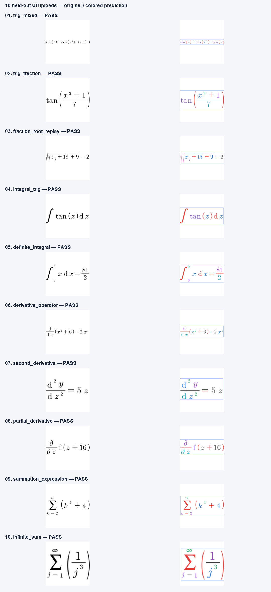

# Calculus checkpoint: UI test results

Best EMA checkpoint: epoch 30; validation mAP@0.50:0.95 0.986153.

Exact equations: 10/10. Actual CPU inference at confidence 0.50, using the Streamlit upload path.

The 10 synthetic test images were selected before inference. Their formula groups are absent from training.
Original/colored images, predictions and steps are saved in the folders linked below.

| Image family | Exact LaTeX | Step controls/cache | Artifacts |
| --- | --- | --- | --- |
| trig_mixed | PASS | PASS | [01_trig_mixed](01_trig_mixed/predicted_latex.txt) |
| trig_fraction | PASS | PASS | [02_trig_fraction](02_trig_fraction/predicted_latex.txt) |
| fraction_root_replay | PASS | PASS | [03_fraction_root_replay](03_fraction_root_replay/predicted_latex.txt) |
| integral_trig | PASS | PASS | [04_integral_trig](04_integral_trig/predicted_latex.txt) |
| definite_integral | PASS | PASS | [05_definite_integral](05_definite_integral/predicted_latex.txt) |
| derivative_operator | PASS | PASS | [06_derivative_operator](06_derivative_operator/predicted_latex.txt) |
| second_derivative | PASS | PASS | [07_second_derivative](07_second_derivative/predicted_latex.txt) |
| partial_derivative | PASS | PASS | [08_partial_derivative](08_partial_derivative/predicted_latex.txt) |
| summation_expression | PASS | PASS | [09_summation_expression](09_summation_expression/predicted_latex.txt) |
| infinite_sum | PASS | PASS | [10_infinite_sum](10_infinite_sum/predicted_latex.txt) |

Symbol precision / recall / F1 at IoU ≥ 0.50: 1.000000 / 1.000000 / 1.000000.

These synthetic results do not establish accuracy on arbitrary screenshots or handwriting.

